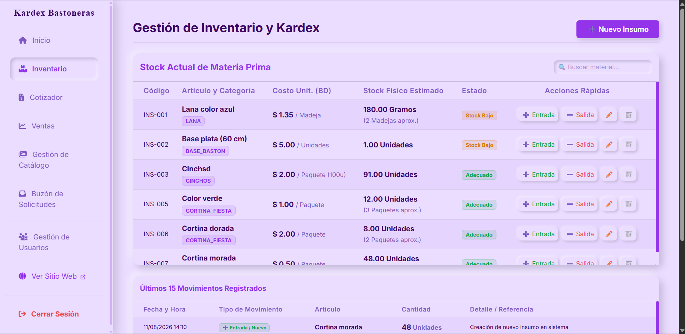
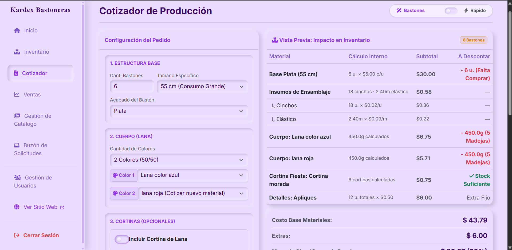
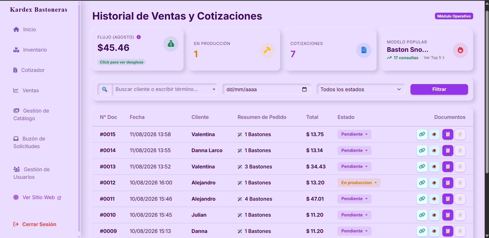
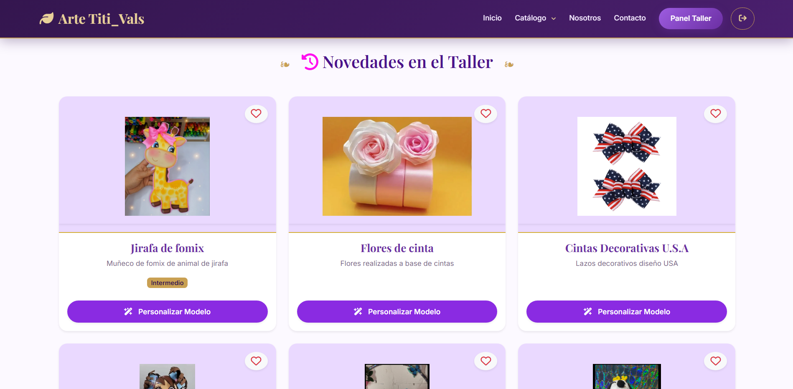

# Sistema ERP & Cotizador BTO — Taller Arte Titi_Val

Plataforma web integral bajo modelo Built-to-Order (BTO) para la gestión operativa y manufactura a medida de bastones institucionales y manualidades. Centraliza desde el catálogo público de captación y el cotizador reactivo hasta el control de inventario (Kardex) y el módulo de despacho.

🌐 **En producción:** [artetitival.com](https://artetitival.com) · **Versión:** 2.1 (noviembre 2026)

---

## 📖 Contexto y Reto de Negocio

El taller operaba con estimaciones empíricas de insumos (lana, elásticos, bases pre-cortadas), sin trazabilidad de mermas ni control digital de inventario. Esto derivaba en paros imprevistos de producción y presupuestos inexactos.

**Solución:** Un sistema web desacoplado en dos capas:

- **Capa Pública / BTO:** Catálogo dinámico que genera prospectos sin exponer la lógica de costos ni los márgenes del taller.
- **Capa ERP Interna:** Panel administrativo con motor de cálculo reactivo, control de inventario en unidades mínimas de consumo (gramos/unidades) y módulo de despacho con tolerancia a fallos.

---

## 🛠️ Stack Tecnológico

- **Backend:** PHP 8.3 / Laravel 13 (MVC, Eloquent ORM)
- **Base de Datos:** MySQL 8.4 (InnoDB, transacciones ACID, Soft Deletes)
- **Frontend:** Blade, JavaScript ES6 modular (Vite), Bootstrap 5
- **Componentes UI:** Select2 (AJAX), SweetAlert2, Fetch API
- **Infraestructura:** Docker + Docker Compose (Nginx, PHP-FPM, MySQL), VPS Linux, HTTPS con Let's Encrypt
- **Utilidades:** barryvdh/laravel-dompdf (PDFs en RAM), Compressor.js (optimización de imágenes en cliente), spatie/laravel-sitemap
- **Seguridad:** Google Socialite (OAuth 2.0), Google reCAPTCHA v3

---

## 🏗️ Decisiones Arquitectónicas Clave

### 1. Desacoplamiento MRP
El cotizador y el guardado de pedidos operan como una reserva matemática. El descuento físico en bodega solo se ejecuta de forma transaccional (`DB::beginTransaction`) cuando el pedido pasa a estado "Realizado/Despachado".

### 2. Doble Perímetro de Seguridad
Aislamiento total mediante middlewares por rol (`super_admin`, `admin`, `cliente`). Los clientes acceden a su historial de proformas sin acceso a endpoints internos de costos, inventario o fórmulas de producción.

### 3. Despacho Resiliente (Deuda de Inventario)
Algoritmo de búsqueda inteligente (`LIKE` y mapeo por categoría) que tolera variaciones de nomenclatura. Si el stock físico es insuficiente, el sistema aplica un modelo *Soft Fail*: asume saldos negativos controlados y emite alertas visuales sin frenar la cadena logística.

### 4. Modularización Frontend (SoC)
El formulario de cotización se refactorizó de un archivo monolítico a módulos ES6 independientes (`modulo_lana.js`, `modulo_cortinas.js`, etc.) orquestados por un script principal y optimizados con Vite.

### 5. Fuente Única de la Verdad (SSOT) *(nuevo en v2.1)*
Las reglas de negocio (gramos por madeja, metros por rollo, precios de diseños, umbrales de mayoreo, etc.) viven exclusivamente en la tabla de ajustes. Blade, JavaScript (`CONFIG_NEGOCIO`) y los PDF leen de ahí: un cambio del administrador se refleja a la vez en interfaz, calculadora y comprobantes.

### 6. Excepciones centralizadas (abierto/cerrado) *(nuevo en v2.1)*
Los casos especiales del descuento de inventario se resuelven con una lista central (`FRAGMENTOS_IGNORABLES`) en lugar de condicionales dispersos. Ejemplo: la modalidad "Sin bastón" se implementó añadiendo dos entradas a esa lista.

### 7. Errores silenciosos hacia el usuario *(nuevo en v2.1)*
La falla real se registra con `Log::error()` en `storage/logs/laravel.log`; con `APP_DEBUG=false` el usuario solo recibe un mensaje genérico, nunca SQL ni trazas.

---

## 🧩 Módulos del Sistema

| Módulo | Responsabilidad |
|--------|-----------------|
| **Kardex** | Registro continuo de entradas/salidas en unidad mínima. Motor traductor visual (ej. madejas/rollos en UI, gramos/metros en BD). Restauración segura de insumos eliminados y precio comercial histórico inmutable. |
| **Cotizador** | Motor de cálculo reactivo con costeo fraccional, reglas de negocio dinámicas (Cost-Plus) y blindaje contra *race conditions*. Imagen de referencia en ambos modos (Bastones y Rápido), modalidad "Sin bastón" y bloqueo de la interfaz tras guardar (*UI Freeze*). |
| **Puente BTO** | Sincronización transaccional bidireccional entre solicitudes web (`quote_requests`) y órdenes de producción (`pedidos`). |
| **Ventas y Despacho** | Vista rápida asíncrona, trazabilidad histórica, gestión de imágenes en pedidos ya creados (adjuntar, reemplazar, eliminar) y ejecución del algoritmo de descuento cruzado de inventario. |
| **Catálogo y Reseñas** | Landing page B2C, carga asíncrona de recursos, sistema de calificación AJAX e integración directa con API de WhatsApp. |
| **Configuración Global** | Panel SuperAdmin basado en diccionario clave-valor para modificar márgenes, precios base, rendimientos de insumos y datos de contacto sin tocar código fuente. |

---

## ✨ Novedades de la v2.1

### 📦 Inventario (Kardex)
- **Migraciones estabilizadas:** `php artisan migrate:fresh --seed` corre limpio de principio a fin.
- **Restauración de insumos eliminados:** registrar un insumo que está en la papelera lo restaura (`withTrashed()` + `restore()`), conservando su historial de recetas y registrando el movimiento en el Kardex.
- **Precio comercial inmutable:** se guarda el precio realmente pagado (`precio_comercial`) junto al costo fraccionado, de modo que cambiar una regla global ya no altera el precio histórico mostrado.
- **Categorías parametrizables:** el mapeo categoría → regla se lee de ajustes (`mapaCategorias()`), con valor histórico de respaldo.

### 🧮 Cotizador y Ventas
- **Imagen de referencia** en cotización manual, incluida en el PDF de la nota (con retrocompatibilidad con el flujo BTO web).
- **Modalidad "Sin bastón":** el cliente aporta su propia base; se conserva la geometría para calcular lana, elástico y cinchos, pero el tubo no se cobra ni se descuenta del Kardex.
- **UI Freeze:** tras guardar, el formulario queda en solo lectura hasta iniciar un nuevo pedido, para que la pantalla siempre coincida con lo persistido.
- **Etiquetas y PDF dinámicos:** todo texto y cálculo sale de la tabla de ajustes (9 llaves nuevas).

### 🔐 Seguridad
- Validación estricta en controladores: imágenes (jpg, jpeg, png, webp; máx. 4 MB), montos, tamaño del carrito y categorías permitidas.
- Escape de comodines en búsquedas, bloqueo de *path traversal* y transacciones con bloqueo de fila.
- Enmascaramiento de excepciones en producción.

### 🐳 Infraestructura y Producción
- **Contenedores:** `web` (Nginx), `app` (PHP 8.3-FPM) y `db` (MySQL 8.4 con volumen persistente).
- **HTTPS** con Let's Encrypt y redirección permanente 301.
- **Despliegue repetible** con `deploy.sh`: sincronización con `origin/main`, compilación Vite, `composer install`, migraciones, `storage:link`, limpieza de cachés, permisos y reinicio de contenedores.
- **Prueba de carga (k6):** 200 usuarios concurrentes, 296 peticiones, **100 % de éxito**.
- **Go-live:** 6 de noviembre de 2026 en VPS Linux.

### 🔎 SEO y Visibilidad
- Dominio verificado en Google Search Console.
- Sitemap dinámico con `spatie/laravel-sitemap` (`php artisan sitemap:generate`).
- Auditoría Lighthouse en producción:

| Best Practices | SEO | Accesibilidad | Rendimiento |
|:---:|:---:|:---:|:---:|
| **100** | **92** | **86** | **70** |

---

## 📸 Capturas de Pantalla

| Kardex / Inventario | Cotizador Reactivo |
| :---: | :---: |
| *Trazabilidad de insumos en tiempo real* | *Cálculo de costos con costeo fraccional* |
|  |  |

| Panel de Control | Catálogo Público BTO |
| :---: | :---: |
| *KPIs, centro de alertas y gestión de ventas* | *Vitrinas interactivas y solicitudes de cotización* |
|  |  |

---

## 🚀 Instalación Local

Puedes ejecutar el proyecto de dos formas: con **Docker** (igual que producción) o con un entorno PHP local.

### Opción A — Docker (recomendada)

```bash
git clone https://github.com/Alej673/sistema-bastones.git
cd sistema-bastones
cp .env.example .env
```

En el `.env` usa `DB_HOST=db` y `APP_URL=http://localhost`. Luego levanta los contenedores y prepara la aplicación **dentro** del contenedor `app` (desde el host, `db` no resuelve fuera de la red de Docker):

```bash
docker compose up -d --build

docker compose exec app composer install
docker compose exec app php artisan key:generate
docker compose exec app php artisan storage:link
docker compose exec app php artisan migrate --seed

# Compilación del frontend (en el host, requiere Node.js 20.x)
npm install
npm run build
```

> ⚠️ `docker compose down -v` elimina el volumen de la base de datos. Úsalo solo en desarrollo.

### Opción B — Entorno PHP local (Laragon, XAMPP, etc.)

```bash
git clone https://github.com/Alej673/sistema-bastones.git
cd sistema-bastones
composer install
npm install
cp .env.example .env
php artisan key:generate
```

Configura tu base de datos en el archivo `.env`. De forma opcional pero recomendada, configura también tus credenciales de `MAIL_` (Mailtrap), `GOOGLE_CLIENT_ID` (OAuth) y `RECAPTCHA_SITE_KEY`.

Luego, crea el enlace simbólico de almacenamiento, migra la base de datos y compila los assets:

```bash
# Enlace simbólico obligatorio para visualizar las imágenes del catálogo
php artisan storage:link

# Migrar y poblar la base de datos
php artisan migrate --seed

# Compilar los assets del frontend para producción
npm run build

# Iniciar el servidor local
php artisan serve
```

> Si existe el archivo `public/hot` (de `npm run dev`), elimínalo antes de compilar: hace que Laravel busque el servidor de Vite en el puerto 5173.

### 🌍 Despliegue en producción

El despliegue se automatiza con `deploy.sh`. Antes de hacer *push*, prueba siempre en local con `APP_DEBUG=false` y Vite compilado para simular producción.

Requisitos en el servidor: Docker + Docker Compose, Node.js 20.x (para `npm run build`), certificados HTTPS y `APP_DEBUG=false` con `APP_URL` en `https://`.

```bash
./deploy.sh
```

> ⚠️ `AjustesTableSeeder` ejecuta `truncate()`: correr `php artisan db:seed --class=AjustesTableSeeder` borra los valores editados desde el panel de ajustes. Respalda la tabla antes de ejecutarlo en producción.

---

### 🔑 Credenciales de Acceso (Demo Local)

Al ejecutar las migraciones con `--seed`, el sistema genera automáticamente dos cuentas de prueba para evaluar los distintos perímetros de seguridad:

**1. Super Administrador (Acceso total y Configuración Global)**
- **Correo:** `admin@demo.com`
- **Contraseña:** `admin123`

**2. Administrador de Taller (Kardex, Cotizador y Despachos)**
- **Correo:** `taller@demo.com`
- **Contraseña:** `admin123`

*(Para registrar una cuenta con rol de "Cliente", puedes utilizar el flujo de registro normal en la pantalla de inicio).*

---

## 🗺️ Próximos Pasos

- Copias de seguridad automáticas de la base de datos.
- Configuración de SPF, DKIM y DMARC para el correo transaccional.
- Programar `sitemap:generate` en el *schedule* de Laravel.
- Optimización de rendimiento: imágenes WebP y cabeceras de caché en Nginx (meta: Performance > 85).
- Mejoras de accesibilidad (contraste y atributos descriptivos).
- Diagrama E-R actualizado y pruebas automatizadas.

---

## 🔗 Enlaces del Proyecto

- **Sitio en producción:** [artetitival.com](https://artetitival.com)
- **Repositorio:** [github.com/Alej673/sistema-bastones](https://github.com/Alej673/sistema-bastones)
- **Video Demostración Técnica:** [Ver en YouTube (Arquitectura y Módulos)](https://www.youtube.com/watch?v=OHmGes--sms)
- **Manual / Guía de Usuario:** [Enlace Drive](https://drive.google.com/file/d/1ENVcdZkvP_v1N2SrP-pfbQPsirlW1aK3/view?usp=sharing)
- **Caso de estudio (portafolio):** [Análisis técnico y arquitectura](https://alej673.github.io/proyecto-bastones.html)

---

**Autor:** Alejandro Larco
[LinkedIn](https://www.linkedin.com/in/alejandro-larco-03297b42a/) · [GitHub](https://github.com/Alej673)

Proyecto de Integración Curricular (PTIC) — Titulación en Desarrollo de Software.
